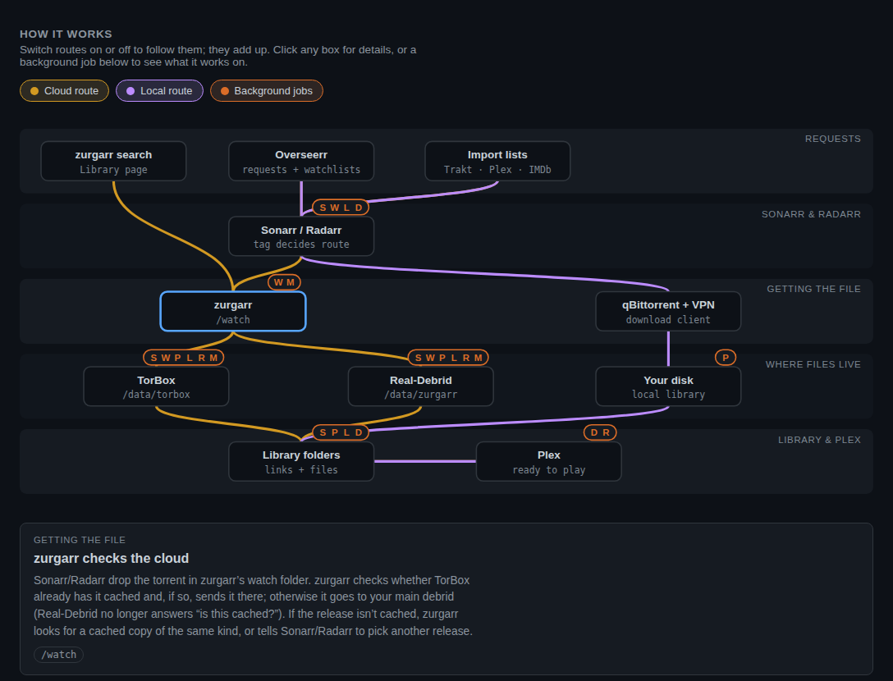

# Zurgarr

Local media and debrid content, managed as one library — for Plex, Jellyfin, Sonarr, and Radarr.

## What is Zurgarr?

Zurgarr bridges your local media library and your debrid account(s) —
Real-Debrid, optionally alongside TorBox — so your *arr stack and media
server see them as one unified library instead of two parallel systems.

At its base it packages
**[Zurg](https://github.com/debridmediamanager/zurg-public)** (WebDAV
for your Real-Debrid account), **[rclone](https://github.com/rclone/rclone)**
(mounts it as a local directory), and optionally
**[plex_debrid](https://github.com/itsToggle/plex_debrid)** (watchlist
automation) into a single Alpine container — your media server
sees debrid content as local files, no downloading, no local storage.

On top of that foundation it adds an integration layer: a source-aware
Library browser that combines local + debrid content with
per-item preferences, automatic debrid symlinks so Sonarr/Radarr can
discover debrid-only content, TMDB-driven gap-fill across both backends,
a Sonarr/Radarr blackhole with cache-aware quality compromise, a
self-healing routing audit, and a browser-based settings editor.
Mixed setups feel like one library, not two.

## Why this project?

> [!NOTE]
> Zurgarr started as a fork of
> [pd_zurg](https://github.com/I-am-PUID-0/pd_zurg) by
> [I-am-PUID-0](https://github.com/I-am-PUID-0), which was deprecated in
> favor of [DUMB](https://github.com/I-am-PUID-0/DUMB). After substantial
> divergence the project was renamed to Zurgarr to fit the *arr ecosystem
> naming convention and signal that it's its own thing now. The
> MIT-licensed lineage is preserved with full attribution.

pd_zurg's contribution was packaging three services into one container.
Zurgarr keeps that packaging and adds an integration layer that treats
local files and debrid content as one library to manage, reconcile, and
observe. Capabilities grouped by intent:

**Unified library — make two sources feel like one**

- Source-aware **Library browser** combining debrid + local content with
  TMDB metadata, per-item source preferences (Prefer Local /
  Prefer Cloud), and episode-level switch controls
- **Auto debrid symlinks** (with `BLACKHOLE_SYMLINK_ENABLED` and a local
  library path) — debrid content Sonarr/Radarr are missing is linked into
  their own folders so they can discover and manage it alongside local
  files. Sonarr/Radarr stay in charge: nothing is linked for a title they
  don't have, for an episode/movie they already hold, or while a download
  of it is on its way into them
- **Dual-debrid** — run TorBox alongside Real-Debrid; each blackhole grab
  is routed to whichever side has it cached, and TorBox content gets its
  own mount and Plex library
- **Interactive search** across Torrentio and (optionally) every
  Prowlarr indexer, with per-provider cache annotations and one-click
  add-to-debrid, straight from the Library detail view
- **Cross-machine setup** — expose Zurg's WebDAV and mount the debrid
  library from any host, not just the Zurgarr container

**Sonarr/Radarr integration — blackhole + smart reconciliation**

- **Blackhole watch folder** with per-arr label routing (each arr sees
  only its own items) and symlink creation after the debrid download
  resolves — see the [Blackhole Symlink Guide](BLACKHOLE_SYMLINK_GUIDE.md)
- **Quality compromise engine** — when a strict profile turns up no
  cached releases, cache-aware tier escalation finds the best cached
  alternative within the arr's profile; Sonarr's normal upgrade path
  reclaims the preferred tier later
- **Season-pack fallback** probes cached packs at the preferred tier
  before any tier drop for shows with many holes
- **TMDB gap-fill** — for every monitored show, diffs the aired-episode
  list against what exists across debrid + local and searches
  Sonarr/Radarr for the missing pieces, regardless of source preference
- **Wanted recovery** — for titles the arr never grabbed, searches
  Torrentio/Prowlarr directly and adds a cached release straight to
  debrid, bypassing the arr's indexer pool; optional Tautulli watch
  history puts titles people actually watch first
- **Debrid-account dedup + require-cached gates** stop uncached junk and
  duplicate hashes from landing in your account in the first place
- **Seerr request writeback** (opt-in) — marks Overseerr/Jellyseerr
  requests available when Zurgarr delivers them, and declines movie
  requests it has given up on, so requests don't sit at "processing"
  forever

**Self-healing — fewer manual interventions**

- **Routing audit auto-tag** applies the debrid tag to monitored
  Sonarr/Radarr media missing a routing tag (self-heals Overseerr
  requests that arrive with empty tags)
- **Symlink verify + repair** detects broken symlinks and triggers arr
  re-search so RD cache evictions close automatically
- **Hash blocklist** with configurable auto-expiry prevents re-grab
  loops on terminally failed torrents
- **Debrid health reconciler** finds Real-Debrid torrents that have
  become filter-blocked and (opt-in) blocklists, removes, and re-searches
  them
- **Plex refresh for scanner-delivered content** — TorBox and other
  content that reaches the arr via a disk rescan still triggers a Plex
  library scan, and versions Plex marked "unavailable" while a debrid
  mount was briefly down (a container restart) are rescanned once their
  files are back (not while Plex empties its trash after every scan)
- **Duplicate-link tidy** (opt-in, `LIBRARY_DUPLICATE_TIDY`) — removes
  extra debrid links that duplicate the copy Sonarr/Radarr track (the
  same episode showing two or three times in Plex) and the leftover Plex
  version. Never the media itself — only the links, their subtitle files
  (moved aside) and folders left empty; every removal recorded for undo.
  Duplicates in folders Sonarr/Radarr don't own need the one-time
  `scripts/dedup_library.py` clean-up
- **ffprobe recovery** kills stuck Plex scans on expired debrid links
- **Process auto-restart** with exponential backoff (5 s → 300 s, resets
  after 1 h stable)

**Observability & control**

- Browser-based **status dashboard + Settings editor** with SIGHUP
  reload — edit most env vars without restarting the container (Zurg and
  rclone settings apply on the next container start; the UI says when)
- **Activity history log** — every grab, compromise, symlink event, and
  debrid add, filterable by type and time
- **Debrid quota & expiry dashboard** — per-provider account expiry,
  storage usage, and TorBox torrents about to expire
- **Apprise notifications** across 90+ services (Discord, Telegram,
  Slack, email, etc.) with optional daily digest mode
- **Prometheus metrics endpoint** for Grafana / Alertmanager (canned dashboard in [`grafana/`](grafana/))
- **OAuth device-code flows** for Trakt, Debrid Link, Put.io, Orionoid;
  **MDBList** subscriptions that auto-feed plex_debrid

**Reliability & non-disruption**

- **Atomic config writes** — temp-rename pattern for `.env`,
  `settings.json`, tier-state sidecars, and preference store prevents
  corruption on mid-write container kills
- **Ordered shutdown** with per-service timeouts and elapsed-time logging
- **Docker secrets** support for API keys and tokens
- **Drops into your existing *arr stack** — the debrid path is a
  sidecar alongside qBittorrent/Usenet, not a replacement

## How it works



*System → Config → How it works. Switch routes on and off, click any box for details, or pick a background job to see what it works on.*

Two workflows. Use either or both.

**Watchlist flow** — plex_debrid monitors your watchlists automatically:

```
Watchlist (Plex / Trakt / Overseerr)
  → plex_debrid (search & match)
    → Real-Debrid (cloud cache)
      → Zurg (WebDAV) → rclone (mount, /data/zurgarr by default)
        → Plex / Jellyfin (stream)
```

**Arr + blackhole flow** — Sonarr/Radarr with tag-based routing:

```
Overseerr (requests) → Sonarr / Radarr (tag-based routing)
  │
  ├─ Local path (no debrid tag):
  │    VPN → qBittorrent / Usenet → Local Disk → Plex
  │
  └─ Debrid path (tag: debrid — no VPN needed):
       Blackhole (/watch)
         → Zurgarr (submit to Real-Debrid / TorBox, cache-aware)
           → mount: Zurg + rclone (Real-Debrid) or rclone (TorBox)
             → Symlinks (/completed)
               → Sonarr / Radarr (import) → Plex (stream)
```

Two more routes feed the same library: the **library scan** (with
blackhole symlinks enabled) links debrid content Sonarr/Radarr are missing
straight into their folders (then asks them to rescan and Plex to
refresh), and **Wanted recovery** adds a cached copy of something they
never grabbed directly to the debrid account.

## Quick Start

### Prerequisites

- A **Linux Docker host** (not Docker Desktop — it lacks
  [mount propagation](https://docs.docker.com/storage/bind-mounts/#configure-bind-propagation)
  support)
- A [Real-Debrid](https://real-debrid.com/apitoken) account with an API
  key. Optional extras:
  - **[TorBox](https://torbox.app/settings)** as a co-debrid alongside
    Real-Debrid. Its mount goes through rclone's WebDAV (Zurg can't serve
    TorBox), so it also needs `TORBOX_WEBDAV_USER` / `TORBOX_WEBDAV_PASS` —
    see [TorBox co-debrid](CONFIGURATION.md#torbox-co-debrid-mount-plan-39)
  - **[AllDebrid](https://alldebrid.com/apikeys/)** instead of Real-Debrid
    only works with Zurg's sponsors-only nightly build (`GITHUB_TOKEN` +
    `ZURG_VERSION=nightly`); public Zurg is Real-Debrid only
- FUSE support on the host (`/dev/fuse`)

### 1. Build the image

```bash
docker build -t zurgarr https://github.com/fjmerc/zurgarr.git
```

### 2. Create directories

The example compose file keeps everything under `/zurgarr` on the host:

```bash
sudo mkdir -p /zurgarr/{config,log,cache,mnt,RD,AD}
```

### 3. Configure

```bash
# Download the compose file, and the example settings into config/.env
wget https://raw.githubusercontent.com/fjmerc/zurgarr/master/docker-compose.yml
sudo wget https://raw.githubusercontent.com/fjmerc/zurgarr/master/.env.example -O /zurgarr/config/.env

# Edit — at minimum set:
#   RD_API_KEY        (plus TORBOX_API_KEY + TORBOX_WEBDAV_* for TorBox)
#   STATUS_UI_AUTH    (e.g., admin:yourpassword)
sudo nano /zurgarr/config/.env
```

Zurgarr reads `config/.env` itself, and the Settings page edits the same
file, so every setting works from there. A value set in the compose file's
`environment:` section overrides it (and shows as read-only in Settings).
The [`.env.example`](.env.example) is commented inline; the full reference
lives in [CONFIGURATION.md](CONFIGURATION.md).

### 4. Start

```bash
docker compose up -d
```

### 5. Verify

- Status dashboard at `http://your-host:8080/status`
- Zurg and rclone should show as **Running**
- Mount check: `ls /zurgarr/mnt/zurgarr/` should show your debrid library
  categories (and `ls /zurgarr/mnt/torbox/` your TorBox library — the
  default `RCLONE_MOUNT_NAME` / `TORBOX_MOUNT_NAME`)

### Updating

There are no published images — rebuild and restart:

```bash
docker build -t zurgarr https://github.com/fjmerc/zurgarr.git
docker compose up -d
```

## Choose your workflow

### Option A: Watchlist mode (plex_debrid)

Best if you want fully automated content from Plex watchlists, Trakt, or
Overseerr — no Sonarr/Radarr needed.

```bash
PD_ENABLED=true
PLEX_USER=your_plex_username
PLEX_TOKEN=your_plex_token
PLEX_ADDRESS=http://192.168.1.100:32400

# Optional: auto-refresh Plex library when new content appears
PLEX_REFRESH=true
PLEX_MOUNT_DIR=/rclone/zurgarr   # the mount as Plex sees it (Plex companion below)

# Optional: Overseerr integration
SEERR_API_KEY=your_key
SEERR_ADDRESS=http://overseerr:5055
```

For **Jellyfin/Emby**, use `JF_ADDRESS` and `JF_API_KEY` instead. Note:
Jellyfin requires
[additional plex_debrid setup](https://github.com/itsToggle/plex_debrid#open_file_folder-library-collection-service)
for Trakt Collections.

### Option B: Arr + blackhole mode (Sonarr/Radarr)

Best if you already use Sonarr/Radarr and want debrid as a download
client alongside (or instead of) qBittorrent/Usenet.

```bash
PD_ENABLED=false                # Not needed — Sonarr/Radarr handle discovery
BLACKHOLE_ENABLED=true
BLACKHOLE_SYMLINK_ENABLED=true
BLACKHOLE_RCLONE_MOUNT=/data/zurgarr
BLACKHOLE_SYMLINK_TARGET_BASE=/mnt/debrid   # Path as seen by Plex/Sonarr/Radarr host(s)

# Optional: skip content you already have
BLACKHOLE_DEDUP_ENABLED=true
BLACKHOLE_LOCAL_LIBRARY_TV=/data/media/tv
BLACKHOLE_LOCAL_LIBRARY_MOVIES=/data/media/movies

# Recommended: tell Plex to scan when debrid content lands
PLEX_REFRESH=true
PLEX_ADDRESS=http://192.168.1.100:32400
PLEX_TOKEN=your_plex_token
# PLEX_MOUNT_DIR is only for Zurg's own refresh hook (see Option A); without
# it the log notes that hook is skipped — the library scan's refresh still runs
```

The symlinks point at `BLACKHOLE_SYMLINK_TARGET_BASE` (TorBox content at
`BLACKHOLE_SYMLINK_TARGET_BASE_TORBOX`, by default the same path +
`_torbox`), so Plex and Sonarr/Radarr must see the debrid mounts at those
paths — e.g. `/zurgarr/mnt/zurgarr:/mnt/debrid` and
`/zurgarr/mnt/torbox:/mnt/debrid_torbox` in their containers.

**Add volumes** in `docker-compose.yml`:

```yaml
volumes:
  - /opt/blackhole:/watch            # Sonarr/Radarr drop .torrent files here
  - /opt/completed:/completed        # Zurgarr creates symlinks here
  # Local library (read-write — needed for auto debrid symlinks;
  # :rslave so a network share mounted after boot still shows up):
  - /path/to/library/tv:/data/media/tv:rslave
  - /path/to/library/movies:/data/media/movies:rslave
```

See the **[Blackhole Symlink Guide](BLACKHOLE_SYMLINK_GUIDE.md)** for
Sonarr/Radarr download-client configuration, multi-host NFS,
verification steps, and troubleshooting.

### Option C: Both

Run plex_debrid and blackhole simultaneously. Set `PD_ENABLED=true` and
`BLACKHOLE_ENABLED=true`, then use Sonarr/Radarr tags to route specific
content through the blackhole while plex_debrid handles watchlist items.

## Recommended settings per debrid provider

Uncached junk (0%/0-seed entries in DMM) and duplicate hashes are
common pain points. Defaults handle dedup automatically. The
cache-required gates depend on a working cache check, and today only
TorBox has one — so what to flip depends on whether TorBox is configured:

| Your setup | Flip ON in the Settings UI |
|---|---|
| **TorBox configured** (alone or alongside RD/AD) | `BLACKHOLE_REQUIRE_CACHED` — grabs for any provider are checked against TorBox's cache. Add `SEARCH_REQUIRE_CACHED` only if TorBox is your *only* debrid (it refuses every RD/AD add) |
| **Real-Debrid or AllDebrid, no TorBox** | Leave both gates **OFF** — RD and AD no longer offer a cache check, so they would hold back every grab |
| **Using plex_debrid** (any provider) | `PD_ENFORCE_CACHED_VERSIONS` |

Background and more symptom-based fixes in
[TROUBLESHOOTING.md](TROUBLESHOOTING.md).

## Docker Compose

> [!NOTE]
> These examples are starting points. Adjust paths to match your environment.
> They use paths relative to the compose file (`./config`, `./mnt`); the
> Quick Start's compose file uses `/zurgarr/config`, `/zurgarr/mnt` — pick
> one style and use it in every container (`./mnt` here = `/zurgarr/mnt`).

### Base setup

```yaml
services:
  zurgarr:
    container_name: zurgarr
    image: zurgarr:latest
    stdin_open: true
    tty: true
    # Settings live in ./config/.env (the Settings page edits it); anything
    # under `environment:` here would override it and lock it in the UI.
    volumes:
      - ./config:/config
      - ./log:/log
      - ./cache:/cache
      - ./RD:/zurg/RD
      # - ./AD:/zurg/AD             # Uncomment for AllDebrid
      - ./mnt:/data:shared
      ## Uncomment for blackhole mode:
      # - /opt/blackhole:/watch
      # - /opt/completed:/completed
      ## Uncomment for local library (read-write for auto debrid symlinks):
      # - /path/to/library/tv:/data/media/tv:rslave
      # - /path/to/library/movies:/data/media/movies:rslave
    ports:
      - "8080:8080"                  # Status UI
    devices:
      - /dev/fuse:/dev/fuse:rwm
    cap_add:
      - SYS_ADMIN
    security_opt:
      - apparmor:unconfined
      - no-new-privileges
```

### Plex companion

The Plex container should wait for Zurgarr's mount to be ready:

```yaml
  plex:
    image: plexinc/pms-docker:latest
    container_name: plex
    devices:
      - /dev/dri:/dev/dri
    volumes:
      - /path/to/plex/config:/config
      - /path/to/plex/transcode:/transcode
      - ./mnt:/rclone               # rclone mount from Zurgarr — add to Plex library
      # Blackhole mode: also mount it where the symlinks point
      # - ./mnt/zurgarr:/mnt/debrid
      # - ./mnt/torbox:/mnt/debrid_torbox
    environment:
      - TZ=America/New_York
    ports:
      - "32400:32400"
    depends_on:
      zurgarr:
        condition: service_healthy
```

## Web UI & Settings editor

The web UI has five pages:

- **Status** (`/status`) — a Setup check (what's misconfigured, with
  one-click jumps to the setting), process health (Zurg, rclone,
  plex_debrid), mount status, connected-service tiles, system resources,
  and recent events
- **Library** (`/library`) — the unified local + debrid browser with
  per-item preferences and interactive search; the **Wanted** link in the
  sidebar (with a count) opens it filtered to what Sonarr/Radarr are still
  missing
- **Activity** (`/activity`) — the history log, filterable by type and
  time, with **Blocklist** and **Stuck** tabs (blocked torrents; items whose
  automatic retries gave up)
- **System** (`/system`) — scheduled tasks, debrid health and
  quota/expiry cards, running configuration, and a filtered log viewer
- **Settings** (`/settings`) — two tabs:
  - **Zurgarr** — an Essentials card first, then each feature's key
    settings with tuning behind "Show advanced"; automatic values explain
    themselves, and values set in docker-compose are read-only.
    Saving applies changes without a restart (SIGHUP reload)
  - **Watchlist (plex_debrid)** — edit `settings.json` with multi-select
    pickers, list editors, a quality-profile JSON editor, and
    device-code OAuth buttons for Trakt, Debrid Link, Put.io, and Orionoid
  - Each tab can export its config (`.env` / `settings.json`) for backup
    or migration; Settings also backs up and restores the whole
    configuration

Set `STATUS_UI_AUTH` (e.g., `admin:changeme`) to put the whole UI behind
basic auth. Without it, the Settings editor and state-changing actions
stay locked, but the other pages are open to anyone who can reach the
port. `/metrics` is always served without auth, for Prometheus scrapers.
Behind a reverse proxy that rewrites the Host header (and doesn't send
`X-Forwarded-Host`), list its address in `STATUS_UI_TRUSTED_ORIGINS`
(e.g. `https://zurgarr.example.com`), or saves and dashboard buttons fail
with "cross-origin request rejected".

## Docs

- **[CONFIGURATION.md](CONFIGURATION.md)** — every env var, grouped by
  feature, with defaults
- **[TROUBLESHOOTING.md](TROUBLESHOOTING.md)** — symptom-first fixes for
  the common problems
- **[BLACKHOLE_SYMLINK_GUIDE.md](BLACKHOLE_SYMLINK_GUIDE.md)** — complete
  Sonarr/Radarr blackhole setup including symlink mode, multi-host NFS,
  dedup, and diagnostics
- **[ARCHITECTURE.md](ARCHITECTURE.md)** — how the internals fit
  together (for contributors)
- **[CHANGELOG.md](CHANGELOG.md)** — version history and release notes
- **[Migrating from pd_zurg](TROUBLESHOOTING.md#migrating-from-pd_zurg)** —
  what changed in names, paths and settings

## Community

- **Bug reports & feature requests:** [GitHub Issues](https://github.com/fjmerc/zurgarr/issues)
- **Upstream pd_zurg (archived):** [Discussions](https://github.com/I-am-PUID-0/pd_zurg/discussions) | [Discord](https://discord.gg/EPSWqmeeXM)
- **plex_debrid:** [Discussions](https://github.com/itsToggle/plex_debrid/discussions) | [Discord](https://discord.gg/u3vTDGjeKE)

## Credits

Zurgarr builds on the work of:

- **[itsToggle](https://github.com/itsToggle)** — plex_debrid ([affiliate](http://real-debrid.com/?id=5708990) | [PayPal](https://www.paypal.com/paypalme/oidulibbe))
- **[yowmamasita](https://github.com/yowmamasita)** — Zurg ([sponsor](https://github.com/sponsors/debridmediamanager))
- **[ncw](https://github.com/ncw)** — rclone ([sponsor](https://rclone.org/sponsor/))
- **[I-am-PUID-0](https://github.com/I-am-PUID-0)** — original pd_zurg

## Licensing

Code authored for the Zurgarr project (and its pd_zurg lineage in this
fork) is released under the MIT License — see [LICENSE](LICENSE).

This repository also redistributes or vendors third-party components,
each governed by its own upstream terms:

- **rclone** — MIT, see [LICENSES/rclone.LICENSE](LICENSES/rclone.LICENSE)
- **Zurg** — no license declared upstream; the binary is downloaded at
  container startup (image build only bakes its config template)
- **plex_debrid** — no license declared upstream; vendored under
  [plex_debrid/](plex_debrid/) with notes in
  [plex_debrid/ATTRIBUTION.md](plex_debrid/ATTRIBUTION.md)

See [THIRD_PARTY_NOTICES.md](THIRD_PARTY_NOTICES.md) for the full inventory.
